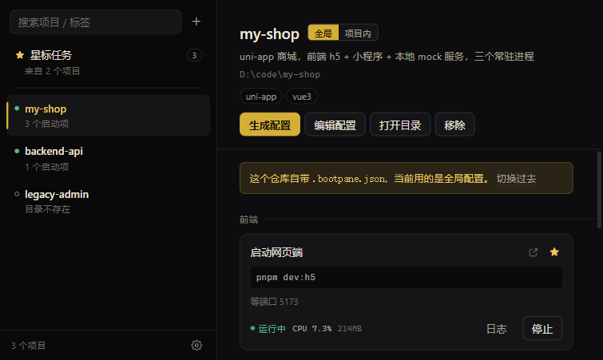
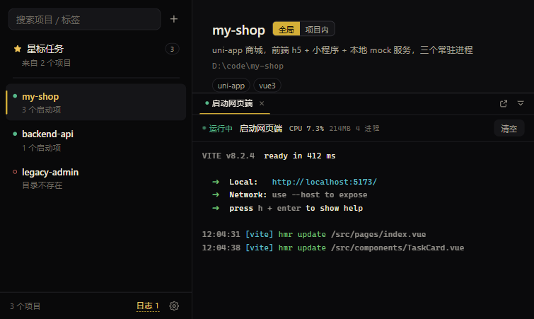

# BootPane

项目启动器。解决的问题只有一个：项目太多，每次都想不起来该怎么起。

把一个目录加进来，它的每种启动方式就是一张卡片上的按钮——大仓库的前端和后端分开起、uni-app 先起网页端再起小程序端，都是一行配置的事。点下去是一个真终端，输出实时进来，「跑没跑起来」由端口或日志关键字判定，而不是 `sleep 3` 猜。





## 功能

**项目与按钮**

- 添加目录即注册项目，侧栏可按名称 / 路径 / 标签搜索；目录被删、配置有错都会在列表上标出来
- 每个项目任意多个启动按钮，按 `group` 分组，可单独指定工作目录和环境变量
- 星标把跨项目的常用按钮聚到一个视图，可以一次性全部启动 / 全部停止

**启动与停止**

- 跑在真终端里（Windows 上走 ConPTY），`pnpm`、`vite` 这类带进度条和颜色的输出原样保留
- 「启动中」和「运行中」分开：只有 `waitFor` 条件满足才算就绪，前端不自己猜状态
- 停止时连整棵进程树一起收（Windows 上由 Job Object 兜底），不会留下占着端口的 node
- 有任务在跑时关窗口会先问一句，避免手滑把所有 dev server 掐掉

**端口与日志**

- 端口占用独立于任务状态检测：服务活着但不是 BootPane 起的进程，卡片上会标「外部运行中」
- 这时点「重启」会先终止端口上的整棵进程树、等端口真正释放，再重新启动
- 日志按任务分标签、跨项目并存，有新输出时标签上有点；整块面板可以弹成独立窗口
- 显示整棵进程树（含 `pnpm → node → vite`）的 CPU、内存和进程数

**配置**

- 两层配置二选一：本机全局注册表（默认）或仓库内 `.bootpane.json`（跟代码一起走、供团队共享）
- 界面上直接编辑 JSON，校验不通过一条都不写盘
- 「生成配置」把一段带 schema 的 prompt 复制给任意模型，粘回结果后走同一个校验器

## 平台支持

目前实际可用的只有 **Windows 10/11**：启动走 ConPTY，进程树靠 Job Object，端口反查与终止走 Toolhelp。跨平台是设计目标而不是现状。

macOS / Linux 的 `pty`、`proctree`、`prockill` 接口已经按最终形态留好（`_unix.go` 里是待实现的桩），业务层没有 `runtime.GOOS` 分支，补平台只需要填这几个文件。

## 快速开始

需要 Go 1.26+、Node.js 20+，以及 Wails v3 CLI：

```bash
go install github.com/wailsapp/wails/v3/cmd/wails3@latest
```

开发模式（前端热更新，后端改动自动重建）：

```bash
wails3 dev
```

只想调界面的话不用起 Go 侧，前端自带假数据：

```bash
cd frontend
npm install
npm run dev      # http://127.0.0.1:9245
```

构建可执行文件和 Windows 安装包：

```bash
wails3 build     # bin/bootpane.exe
wails3 package   # NSIS 安装包，需要本机装有 makensis
```

跑测试：

```bash
go test ./...
cd frontend && npm run check
```

首次运行时会把当前目录登记成项目（只在目录里有 `go.mod` 时生效），所以 `wails3 dev` 一起来就能直接看到这个仓库。

## 配置

### 放在哪里

默认情况下所有启动按钮都存在本机的全局注册表里，**不需要往仓库里塞任何文件**：

```
%APPDATA%\bootpane\workspace.json
```

每个项目在界面上有个「全局 / 项目内」开关。只有切到「项目内」，才会去读仓库根目录的 `.bootpane.json`——这个文件是可选的，适合想把启动方式跟代码一起提交、供团队共享的场景。

两种来源**二选一，不叠加**：切到项目内之后，全局里配的按钮完全不生效。

仓库里放了 `.bootpane.json` 时，即使当前用的是全局配置，界面也会提示一句「这个仓库自带配置，要不要切过去」。

星标、设置这类纯个人习惯只写进 `workspace.json`，不会跟着 `.bootpane.json` 提交给团队。

### 配置格式

```jsonc
{
  "version": 1,
  "project": {
    "name": "my-shop",
    "description": "uni-app 商城，前端 h5 + 小程序 + 本地 mock 服务",  // 显示在项目头部
    "tags": ["uni-app"]
  },
  "tasks": [
    {
      "id": "web",
      "label": "启动网页端",
      "group": "前端",              // 按钮分组
      "command": "pnpm dev:h5",
      "cwd": ".",                  // 相对项目根目录
      "env": { "PORT": "5173" },
      "waitFor": { "type": "port", "port": 5173, "timeout": 60 },
      "openUrl": "http://localhost:5173",  // 配了就在卡片上显示「打开页面」按钮
      "singleton": true            // 默认 true，防止同一按钮起两份
    },
    {
      "id": "mp-weixin",
      "label": "启动小程序端",
      "group": "小程序",
      "command": "pnpm dev:mp-weixin",
      "dependsOn": ["web"],        // 声明前置任务（运行时等待尚未接入）
      "waitFor": { "type": "log", "log": "Build complete", "timeout": 120 }
    }
  ],
  "pipelines": [
    { "id": "all", "label": "全启", "tasks": ["web", "mp-weixin"], "mode": "serial" }  // 编排，同样尚未接入
  ]
}
```

| 字段 | 说明 |
|---|---|
| `project.name` / `description` / `tags` | 项目元信息，显示在侧栏和标题下 |
| `tasks[].id` | 任务标识，`dependsOn` / `pipelines` 靠它引用 |
| `tasks[].label` | 按钮和日志标签上显示的名称 |
| `tasks[].group` | 按钮分组，同组的卡片排在一起 |
| `tasks[].command` | 交给 shell 执行的完整命令 |
| `tasks[].cwd` | 相对项目根目录的工作目录，默认根目录 |
| `tasks[].env` | 追加的环境变量，和当前进程环境合并 |
| `tasks[].waitFor` | 就绪判定条件，见下 |
| `tasks[].openUrl` | 页面地址，配了才显示「打开页面」 |
| `tasks[].singleton` | 是否禁止重复启动，默认 `true` |

### waitFor：什么算启动完成

这是最关键的一个字段。没有它就只能靠 `sleep 3`，而猜是不准的——端口没起来就启动下一个，下一个必然失败。

- `{"type": "port", "port": 5173}`：等本地端口进入监听状态。
- `{"type": "log", "log": "Build complete"}`：等终端输出里出现关键字。
- `timeout` 单位秒，默认 60。超时算启动失败，状态停在「已失败」并带上原因。

### openUrl：页面地址

配了之后卡片标题旁会出现「打开页面」按钮。前端类任务（`id` / `label` / `group` 里带「前端」「网页」「web」「h5」这类词）即使不配，也会按 `waitFor.port` 兜底成 `http://localhost:<port>`；https、反向代理后的域名、带路径的地址（如 `/admin`）只能显式写。后端 API 不会因为监听端口就挂上这个按钮。

### dependsOn 与 pipelines

这两个字段已经在配置结构和校验器里：依赖指向不存在的任务、依赖成环、编排引用不存在的任务都会在保存时逐条报错并拦住写入。运行时按依赖顺序等待就绪、以及 pipeline 的一键编排还没有接上（见路线图），现在点启动只启动当前这一个任务。

### 用 AI 生成配置

项目详情页右上角有个「生成配置」，点开是两步：

1. **复制 prompt** — 里面写好了 JSON schema、字段规则和当前平台实际使用的 shell。把它拿到**项目根目录下打开的 AI 工具**里粘贴，让模型自己读 `package.json`、`go.mod` 这些文件。不预置仓库摘要，是因为模型现读比我们塞一份可能过期的摘录准得多。
2. **粘回来导入** — 把模型返回的 JSON 粘进去。导入前会跑一遍校验（命令不能为空、`cwd` 必须存在、`dependsOn` 不能指向不存在的任务、不能成环），有问题就逐条列出来且**一条都不写盘**，通过了才存进注册表。

## 代码结构

```
main.go                    应用入口、窗口、服务注册
app_services.go            暴露给前端的 ConfigService / ProcessService
log_window.go              日志面板独立窗口
quit_guard.go              关窗前的运行任务确认
open_url.go / open_with.go 用系统浏览器打开页面、用指定编辑器打开目录
internal/config/           两层配置、合并、校验、prompt 生成
internal/process/          任务状态机、日志环形缓冲、就绪等待
internal/pty/              伪终端接口，Windows(ConPTY)/Unix 分实现
internal/proctree/         进程树容器接口，Windows(Job Object)/Unix 分实现
internal/prockill/         按端口反查并终止外部进程树
internal/portinfo/         端口占用与占用进程查询
internal/editors/          本机编辑器探测（PATH + 安装路径 + 常见 fork）
internal/discovery/        仓库扫描（预留，尚未实现）
internal/win32/            Win32 API 封装
frontend/src/              Svelte 5 界面
```

几个刻意的取舍：

- **状态由后端判定。** 「运行中」只在 `waitFor` 满足时成立，前端只渲染后端推来的状态，避免两边各算一套。
- **平台差异收在接口后面。** 业务代码里没有 `runtime.GOOS` 判断，补 macOS / Linux 时只新增平台文件。
- **配置分两层，二选一。** 「哪些项目属于这台机器」和「这个项目怎么启动」是两件事，前者不该进仓库，后者应该跟着代码走。

## 路线图

已完成：

- 项目注册表、两层配置、校验与合并
- ConPTY 启动、Job Object 终止整棵进程树、`waitFor` 就绪判定
- 实时日志（ANSI 彩色、多标签、独立窗口）、进程树资源占用
- 端口占用检测与「外部实例」重启
- 配置 JSON 编辑、AI 生成配置的复制 / 导入
- 星标跨项目聚合、批量启动 / 停止、关窗保护、编辑器探测

待做：

| 内容 |
|---|
| `dependsOn` 的运行时等待、`pipelines` 一键编排 |
| macOS / Linux 的 `pty` / `proctree` / `prockill` 实现 |
| 内置规则扫描器，减少对复制 prompt 的依赖 |
| 直连 LLM（OpenAI 兼容），省掉手动复制粘贴 |
| 日志落盘、残留进程清理、托盘与快捷键 |

## 参与开发

- Bug 和需求请开 issue，附上系统版本、任务命令和日志面板里的输出
- 提交前请保证 `gofmt` 干净、`go test ./...` 与 `npm run check` 通过
- 注释写「为什么」，不写「是什么」——尤其是和平台 API、时序相关的部分

## 许可证

[MIT](LICENSE)
